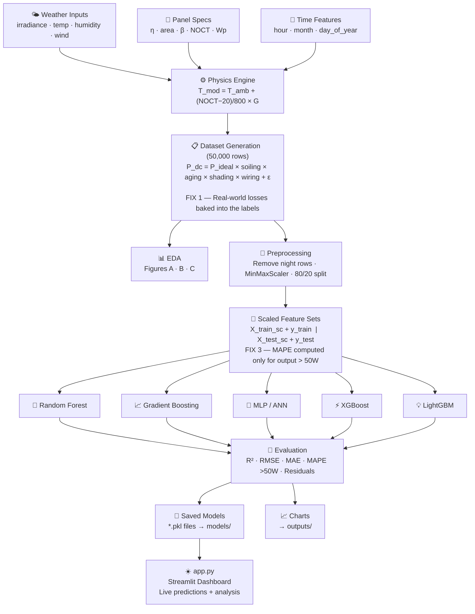
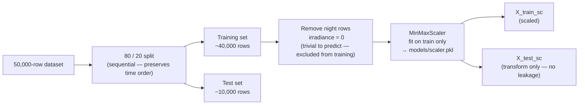
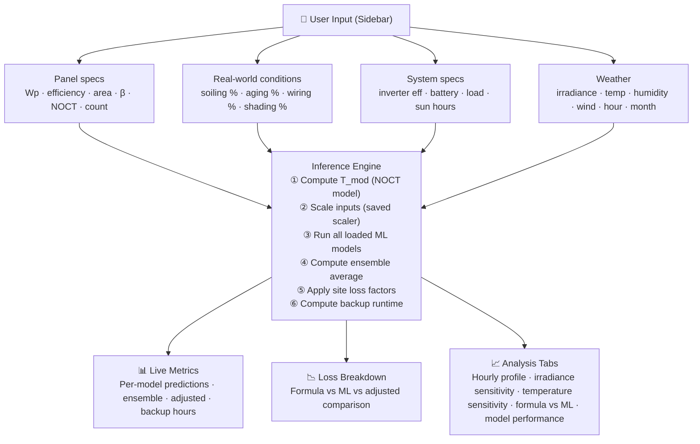
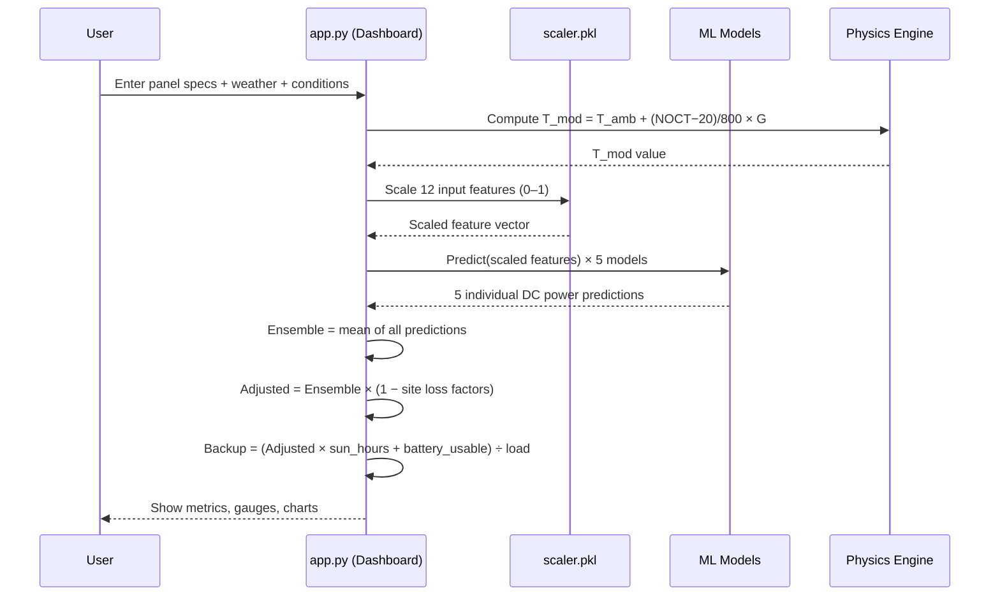

# SolarCast v2 — Project Summary

> **A physics-informed machine learning system that predicts real-world solar panel output and battery backup duration.**

---

## 1. What Is This Project?

**SolarCast v2** is a capstone machine learning project that answers one key question:

> *"Given a solar panel's specs, current weather, and real-world conditions — how many watts will it actually produce, and how long can it power a load?"*

The key insight is that the standard physics formula for solar output:

```
P_ideal = η × A × G × [1 − β × (T_mod − 25)]
```

gives the **ideal** (theoretical maximum) output. But real panels always produce **less** than ideal due to:

- 🌫️ **Soiling** — dust and pollution on the glass
- 📉 **Aging** — panels degrade over time
- 🌲 **Partial Shading** — bypass diodes activate, cutting output significantly
- 🔌 **Wiring & Mismatch losses** — resistive losses in DC cables

**The ML models learn to predict actual real-world output** — accounting for all these losses — which the physics formula alone cannot do.

---

## 2. Project File Structure

```
HopefullyFInal/
│
├── solar_pipeline.py   ← Main training pipeline (run this first)
├── app.py              ← Streamlit web dashboard (run after pipeline)
│
├── data/
│   └── solar_dataset.csv       ← 50,000-row generated training dataset
│
├── models/
│   ├── scaler.pkl              ← MinMaxScaler (fit on training data only)
│   ├── rf_model.pkl            ← Random Forest
│   ├── gb_model.pkl            ← Gradient Boosting
│   ├── mlp_model.pkl           ← MLP / Neural Network
│   ├── xgb_model.pkl           ← XGBoost
│   ├── lgb_model.pkl           ← LightGBM
│   └── best_model.pkl          ← Copy of the highest R² model
│
├── outputs/
│   ├── eda_A_distributions.png ← EDA Figure A: distributions & time patterns
│   ├── eda_B_correlations.png  ← EDA Figure B: correlations & feature plots
│   ├── eda_C_statistics.png    ← EDA Figure C: statistical summary table
│   ├── pipeline_diagram.png    ← Visual diagram of the pipeline
│   ├── model_comparison.png    ← 8-panel evaluation dashboard
│   ├── results_table.png       ← Ranked model results
│   ├── residual_analysis.png   ← Residual histograms per model
│   └── formula_vs_ml.png       ← Physics formula vs ML comparison
│
└── doc/
    └── summary.md              ← This file
```

---

## 3. How to Run

```
# Step 1: Generate data, train models, save outputs
python solar_pipeline.py

# Step 2: Launch the interactive web dashboard
streamlit run app.py
```

---

## 4. Full System Workflow



---

## 5. Data Generation (solar_pipeline.py — Step 1)

The dataset is **synthetically generated** to simulate realistic real-world conditions.

**Why synthetic?** Real solar power datasets (SCADA logs) are proprietary and panel-specific. Generating data lets us precisely control the 4 loss factors so the ML model has a clear, reproducible learning target.

The `generate_dataset(n=50_000)` function builds each row step-by-step:

#### Step A — Time Features
Hour (0–23) and day-of-year (1–365) are drawn randomly. Month is derived from day-of-year by integer division:
```python
month = ((doy - 1) // 30 + 1).clip(1, 12)
```

#### Step B — Irradiance (G)
Irradiance follows a **solar arc sine curve** — highest at solar noon, zero at night:
```python
G_raw = 1000 × sin(π × (hour − 6) / 12)   # peak at noon, zero at 6am/6pm
```
Multiplied by a **seasonal factor** (peaks near summer solstice) and a random **cloud factor** (0.30–1.20) to simulate variable cloud cover:
```python
seasonal = 0.75 + 0.25 × sin(2π × (doy − 80) / 365)
G = clip(G_raw × seasonal × cloud, 0, 1100)
```

#### Step C — Module Temperature (NOCT Model, IEC 61215)
The panel surface runs hotter than the air because glass absorbs radiation. The IEC 61215 standard NOCT formula estimates this:
```
T_mod = T_amb + (NOCT − 20) / 800 × G
```
- `NOCT` (Nominal Operating Cell Temperature, 43–48°C) is a datasheet value unique to each panel type.
- The formula says: for every 800 W/m² of irradiance, the panel heats up by `(NOCT − 20)` degrees above ambient.
- A typical panel at G=800 W/m², T_amb=30°C, NOCT=45°C → T_mod = 30 + (45−20)/800 × 800 = **55°C**.

#### Step D — Ideal Physics Output
The standard photovoltaic formula:
```
P_ideal = η × A × G × [1 − β × (T_mod − 25)]
```
- `η` — panel efficiency (random 14–22% per row, simulating different panel models)
- `A` — panel area in m² (random 1.2–2.0 m²)
- `β` — temperature coefficient (random 0.003–0.005 /°C); each °C above 25°C costs β% of output
- The `[1 − β(T_mod − 25)]` term is the **thermal derating factor** — output drops as the panel heats up

### 5.1 Input Features (12 total)

| Feature | Symbol | Description |
|---|---|---|
| `irradiance` | G (W/m²) | Solar radiation at the panel surface |
| `ambient_temp` | T_amb (°C) | Outside air temperature |
| `module_temp` | T_mod (°C) | Panel surface temperature (from NOCT model) |
| `humidity` | % | Affects cloud cover and soiling rate |
| `wind_speed` | m/s | Cools the panel, reducing T_mod |
| `hour` | 0–23 | Hour of day |
| `month` | 1–12 | Month (seasonal proxy) |
| `day_of_year` | 1–365 | Finer seasonal proxy |
| `efficiency` | η (decimal) | Panel STC efficiency (14%–22%) |
| `panel_area` | A (m²) | Total panel area (1.2–2.0 m²) |
| `temp_coeff` | β (/°C) | Temperature derating coefficient |
| `noct` | °C | Nominal Operating Cell Temperature |

### 5.2 Target Variable

```
dc_power  =  P_ideal × soiling × aging × shading × wiring + sensor_noise
```

Where `P_ideal` is the theoretical formula output. The four **stochastic loss factors** are what make ML necessary:

| Loss Factor | Range | Represents |
|---|---|---|
| Soiling | 0.80 – 1.00 | Dust, pollution, bird droppings on glass |
| Aging | 0.92 – 1.00 | Panel degradation (~0.5%/year) |
| Shading | 0.50 – 0.85 (12% of rows) | Bypass diode activation from partial shade |
| Wiring | 0.95 – 0.99 | Resistive losses + panel mismatch |

**How shading is applied in code:** A 12% random probability decides whether a row has a shade event. If shaded, the factor is drawn from `uniform(0.50, 0.85)`; otherwise it is 1.0:
```python
shade_event    = random() < 0.12
shading_factor = where(shade_event, uniform(0.50, 0.85), 1.0)
```

**Final label formula (what ML must learn to predict):**
```
P_dc = P_ideal × soiling_factor × aging_factor × shading_factor × wiring_factor
       + N(0, 5W)    ← sensor noise
```
The result is clipped to ≥ 0 (negative watts are physically impossible).

Three extra columns are stored in the CSV for EDA only — they are **never used as model inputs**:
- `p_ideal` — the raw formula value before loss factors
- `combined_loss_factor` — product of all four factors (shows how much output was reduced)
- `is_shaded` — 0/1 flag for shade events

> **Why does this make ML necessary?** A clean physics formula cannot predict the combined random effect of all four loss factors — each row gets different random values. ML learns the pattern from 50,000 examples.

---

## 6. Exploratory Data Analysis (Step 2)

Three output figures are generated automatically using `matplotlib`. All plots are saved to `outputs/` at 150 DPI. EDA happens **before** preprocessing so the full 50,000-row dataset (including night rows) is analysed.

| Figure | File | Contents |
|---|---|---|
| A | `eda_A_distributions.png` | Real vs ideal scatter, loss factor distribution, hourly/monthly profiles, shaded vs unshaded, temperature model |
| B | `eda_B_correlations.png` | Correlation heatmap, irradiance vs output, temperature derating curves, efficiency groups, formula gap |
| C | `eda_C_statistics.png` | Full statistical summary table (mean, std, min, max, quartiles, skewness) |

**Key chart: Figure A1 — Real output vs ideal formula** 
This scatter plot is the visual proof that ML is necessary. Points that fall below the diagonal `y = x` line are rows where real output was lower than what the formula predicted — caused by the loss factors. The further below the diagonal, the larger the real-world deviation.

**Key chart: Figure B5 — Formula gap by irradiance level** 
This bar chart shows the average percentage by which the formula overestimates real output, grouped by irradiance levels. It answers: *"How wrong is the formula at 200 W/m² vs 800 W/m²?"* The gap is consistent across all irradiance levels, confirming the losses are not just noise.

---

## 7. Preprocessing (Step 4)



#### How the Split Works
The split is a **sequential slice** (not a random shuffle), which preserves the natural temporal order of the data:
```python
split_idx = int(len(df) * 0.80)   # row 40,000
train_df  = df.iloc[:split_idx]    # first 80%
test_df   = df.iloc[split_idx:]    # last 20%
```
Night rows (`irradiance == 0`) are then filtered **from the training set only**. The test set keeps all hours — because at inference time, a user might query at any hour and the model must return a sensible prediction (0W for night, which it infers from irradiance = 0).

#### MinMaxScaler
Every feature is rescaled to the range [0, 1] so that features with large numeric ranges (e.g. irradiance 0–1100 W/m²) do not dominate features with small ranges (e.g. efficiency 0.14–0.22):
```
x_scaled = (x − x_min) / (x_max − x_min)
```
- The scaler is **fit** (learns `x_min`, `x_max`) only on the training set.
- The test set is **transformed** using the training set's min/max — never re-fit. This prevents **data leakage** (the model must not know anything about the test distribution during training).
- The fitted scaler is saved as `models/scaler.pkl` so `app.py` can apply the same scaling to live user inputs.

> **Why remove night rows from training?** At night, irradiance = 0 and output = 0 trivially. Including them would inflate model scores without testing real prediction ability.

---

## 8. Model Training (Step 5)

Five ML models are trained and compared. They are all **supervised regression** models — given the 12 scaled input features, each learns to predict `dc_power` in Watts.

| Model | Key Hyperparameters | Why These Settings |
|---|---|---|
| **Random Forest** | 300 trees, depth 16, max_features 0.7 | Large ensemble reduces variance; 0.7 feature fraction prevents feature dominance |
| **Gradient Boosting** | 400 estimators, lr=0.05, depth 6 | Slow learning rate with many estimators = better generalisation |
| **MLP / ANN** | Layers (256→128→64), ReLU, early stopping | Decreasing layer sizes form a funnel; early stopping prevents overfitting |
| **XGBoost** | 400 estimators, lr=0.05, depth 7, L1+L2 reg | L1 (reg_alpha) + L2 (reg_lambda) regularisation controls complexity |
| **LightGBM** | 400 estimators, lr=0.05, 63 leaves | Leaf-wise growth (vs depth-wise) makes it faster and often more accurate |

**XGBoost / LightGBM are optional.** The code checks at startup with `try/except ImportError`. If XGBoost is not installed, SVR (RBF kernel) is used instead. If LightGBM is missing, Extra Trees is used. This ensures the pipeline always trains exactly 5 models regardless of the environment.

**Training loop:**
All models go through the same loop — fit on `X_train_sc` / `y_train`, then predict on `X_test_sc`. Predictions are clipped to ≥ 0 (negative watts are impossible):
```python
model.fit(X_train_sc, y_train)
preds = model.predict(X_test_sc).clip(0)
```
After scoring, **all models are saved** to `models/` using `joblib.dump()`. The model with the highest R² is additionally saved as `best_model.pkl`.

All models use the same scaled feature set. Each is saved as a `.pkl` file in `models/`.

---

## 9. Evaluation Metrics (Step 6)

Each model is scored on the held-out test set using four metrics:

| Metric | Formula | Meaning |
|---|---|---|
| **R²** | `1 − SS_res / SS_tot` | How well predictions match actual values (1.0 = perfect, 0 = predicting the mean) |
| **RMSE** | `√( mean((y_true − y_pred)²) )` | Root Mean Square Error in Watts — penalises large errors more than small ones |
| **MAE** | `mean(|y_true − y_pred|)` | Mean Absolute Error in Watts — the average error magnitude, equally weighted |
| **MAPE (>50W)** | `mean(|y_true − y_pred| / y_true) × 100` | Percentage error, **computed only when actual output > 50W** |

**The `compute_metrics()` function** in `solar_pipeline.py` implements this. MAPE uses a boolean mask to exclude low-output rows:
```python
mask = y_true > 50.0          # FIX 3: only productive hours
mape = mean(|y_true[mask] − y_pred[mask]| / y_true[mask]) × 100
```
The same `MAPE_THRESHOLD = 50.0` constant is shared between `solar_pipeline.py` and `app.py` (defined at the top of both files) to ensure consistency.

> **Why the 50W threshold for MAPE?**  
> At dawn/dusk, actual power can be ~3W. Even a good prediction of 5W gives MAPE = 67%, which is misleading. The 50W threshold restricts MAPE to productive daylight hours where accuracy actually matters. *(This is FIX 3.)*

#### Evaluation Charts
All charts are generated with `matplotlib` and saved at 150 DPI to `outputs/`:

- `model_comparison.png` — 8-panel dashboard: R² bars, training time, RMSE, MAPE, radar chart, actual vs predicted, residual histogram, Random Forest feature importance
- `results_table.png` — ranked summary table with all metrics; best model row is highlighted green
- `residual_analysis.png` — one histogram per model showing the distribution of prediction errors (ideally centred at 0)
- `formula_vs_ml.png` — side-by-side scatter + R² bar chart comparing the raw physics formula against every ML model on the same test set

**Feature Importance (Random Forest):** The `feature_importances_` attribute of the trained Random Forest tells us how much each input variable contributed on average to splits across all 300 trees. Irradiance (`G`) is expected to be the most important feature since output scales almost linearly with it.

---

## 10. Streamlit Dashboard (app.py)

After training, `app.py` provides an interactive web interface:



### Dashboard Tabs

| Tab | What It Shows |
|---|---|
| ⏰ Today's Profile | Predicted hourly output from 0–23h, formula vs ML vs adjusted vs AC |
| 🌤️ Irradiance Sensitivity | How output responds to changing solar radiation (0–1100 W/m²) |
| 🌡️ Temperature Sensitivity | Effect of ambient temperature on output |
| 📊 Formula vs ML | Scatter plot proving the physics formula overestimates; R² comparison |
| 🔬 Model Performance | Live accuracy table, R² bar chart, Random Forest feature importance |

#### How the Sidebar Inputs Flow Into a Prediction

1. **Panel specs** → efficiency, area, temp coefficient, and NOCT are read from sliders/inputs. Area is multiplied by `num_panels` (total system area).
2. **Module temperature** is computed live using the NOCT formula: `T_mod = T_amb + (NOCT − 20) / 800 × G`.
3. **The 12-feature row** is assembled in the exact same order as `FEATURES` in `solar_pipeline.py` and passed to the saved `scaler.pkl` — this ensures the same normalisation that was applied during training.
4. **All loaded models** predict on the scaled row. Results are clipped to `max(0, pred)` (no negative watts).
5. **Ensemble average** = simple arithmetic mean of all model predictions.
6. **Site loss adjustment** = Ensemble × `combined_factor`, where `combined_factor = (100 − total_loss_pct) / 100`. The user controls `soiling_pct`, `aging_pct`, `wiring_pct`, and `shading_pct` via sliders.
7. **Backup hours** = `(adjusted_pdc × sun_hours + battery_wh × DoD × inv_eff) / load_w`.

#### Model Loading (Cached)
`@st.cache_resource` loads all `.pkl` files once when the app starts and keeps them in memory. This avoids reloading multi-hundred-MB model files on every user interaction. The training dataset is loaded once with `@st.cache_data` for the Formula vs ML and Model Performance tabs.

---

## 11. The Three Key Fixes

The project evolved through three important corrections from an earlier version:

| Fix | Problem (Before) | Solution (After) |
|---|---|---|
| **FIX 1** | Labels were pure formula output — ML was trivially reproducing a known equation, making it unnecessary | Added 4 real-world stochastic loss factors to labels — ML is now genuinely required |
| **FIX 2** | ML was framed as "replacing" the physics formula | Reframed: formula = ideal baseline; ML = real-world correction layer |
| **FIX 3** | MAPE was computed from 1W threshold — dawn/dusk near-zero values inflated MAPE to 130–155% | MAPE threshold raised to 50W — now only productive hours are measured |

---

## 12. How the Prediction Works End-to-End



#### Full Calculation Breakdown (Step by Step)

The dashboard includes an expandable **"Full Step-by-Step Calculation"** panel that shows the live numbers for each step — useful for thesis defense presentations:

| Step | Formula | What It Computes |
|---|---|---|
| 1 | `T_mod = T_amb + (NOCT − 20) / 800 × G` | Panel surface temperature |
| 2 | `P_ideal = η × A × G × [1 − β × (T_mod − 25)]` | Theoretical maximum (formula baseline) |
| 3 | `P_ml = mean(model₁, model₂, ..., model₅)` | ML ensemble DC prediction |
| 4 | `P_adjusted = P_ml × (1 − total_loss%)` | Real-world adjusted output |
| 5 | `P_ac = P_adjusted × inverter_efficiency` | AC output after inverter |
| 6 | `E_panel = P_adjusted × sun_hours` | Energy from panel today (Wh) |
| 7 | `E_battery = battery_Wh × DoD × inv_eff` | Usable battery energy (Wh) |
| 8 | `E_total = E_panel + E_battery` | Total available energy (Wh) |
| 9 | `backup = E_total / load_W` | How many hours the load can run |

The gap between Step 2 (`P_ideal`) and Step 4 (`P_adjusted`) is precisely why ML is justified over the formula alone.

---

## 13. Key Design Decisions

- **Synthetic data with stochastic losses** — real SCADA datasets are proprietary and hard to obtain; this approach lets us precisely control what the ML model must learn
- **Scaler fit only on training data** — prevents data leakage from test set statistics flowing into training
- **Night rows removed from training** — keeps the model focused on the non-trivial prediction problem (daytime output)
- **Ensemble average** — averaging 5 diverse models reduces variance and is more robust than any single model
- **MAPE >50W threshold** — produces a meaningful, honest accuracy metric for academic/professional presentation
- **`SEED = 42` everywhere** — `np.random.seed(42)` and `random_state=42` are set on all models so results are fully reproducible across runs
- **Panel specs randomised per row** — efficiency (14–22%), area (1.2–2.0 m²), β (0.003–0.005), NOCT (43–48°C) are all random, so a single trained model generalises to any panel type without retraining
- **`joblib` for model persistence** — `joblib.dump` / `joblib.load` is faster than Python `pickle` for large numpy-heavy sklearn objects like Random Forest (which becomes ~181 MB on disk)
- **Plotly in dashboard, matplotlib in pipeline** — `solar_pipeline.py` uses `matplotlib` (static PNGs for reports); `app.py` uses `plotly` (interactive hover, zoom, export) for a better user experience
